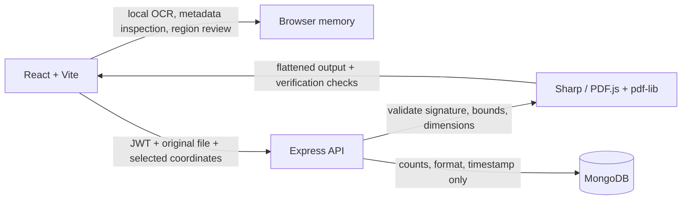

# ShareSafe

**ShareSafe: A Privacy-Preserving Personal Information Detection and Redaction System** is a student project for finding likely personal details in images and PDFs and irreversibly covering user-selected regions.

## What it does

- Registers users, hashes passwords with bcrypt, and protects private APIs with JWTs.
- Runs Tesseract OCR in the browser. OCR text is not sent to the server or saved.
- Detects likely email addresses, phone numbers, and configured `SSN`, `ID`, and `ACCOUNT` labels. Detection is a convenience, not a guarantee; manually review the image and add boxes for anything OCR misses.
- Accepts PNG, JPEG, and PDF files. PDFs are rendered locally for OCR and review; selected coordinates are applied after the server independently renders the original PDF.
- Validates image signatures through Sharp, limits images to 10 MB and 6,000 × 6,000 pixels, limits PDFs to 4 MB and 8 pages, and caps selections at 50 regions.
- Rasterizes PDF pages in memory, covers selected regions, and rebuilds a flattened, image-only PDF. The server verifies the page count, image content, and absence of searchable text before returning it. Image uploads are flattened to PNG as before.
- Stores only the user ID, timestamp, original format, and category counts for history. It never stores uploaded files, OCR text, sensitive values, or plaintext passwords.

## Requirements

- Node.js 22.13 or later (PDF.js 6 runtime requirement)
- MongoDB 6 or later (local install or a MongoDB Atlas connection string)

## Setup

1. Install dependencies from the repository root:

   ```bash
   npm run install:all
   ```

2. Copy `server/.env.example` to `server/.env`. Set `MONGODB_URI` and a random `JWT_SECRET` of at least 32 characters. `CLIENT_ORIGIN` should match the Vite origin (`http://localhost:5173` by default). Keep `.env` private.

3. Optionally copy `client/.env.example` to `client/.env` and set `VITE_API_URL` (default `http://localhost:4000`).

4. Start MongoDB. For a local service, confirm it accepts connections at `mongodb://127.0.0.1:27017`.

5. Start both apps:

   ```bash
   npm run dev
   ```

   Open `http://localhost:5173`. The API listens on `http://localhost:4000`.

6. Create a fabricated test image (never use real identity documents):

   ```bash
   npm --prefix server run sample
   ```

   The generated `sample-synthetic.png` is ignored by Git. You can also choose an image you create yourself.

## Checks

```bash
npm test
npm run build
```

The server and client tests use Node's built-in test runner and cover redaction pixels, image orientation, PDF flattening and verification, region validation, API validation, authentication gates, user-scoped history queries, CORS policy, risk scoring, editor coordinate mapping, and report masking. Tests use synthetic fixtures. Database-backed registration and full API history integration require MongoDB; start MongoDB and the API for that workflow. Browser UI and Tesseract require the Vite app in a browser.

## API

| Method | Path | Access | Purpose |
| --- | --- | --- | --- |
| `POST` | `/api/auth/register` | Public, rate limited | Create account and return JWT |
| `POST` | `/api/auth/login` | Public, rate limited | Verify credentials and return JWT |
| `GET` | `/api/health` | Public | API liveness |
| `POST` | `/api/redact` | Bearer JWT | Multipart `image` plus JSON `regions`; returns a flattened PNG or PDF |
| `GET` | `/api/history` | Bearer JWT | Return up to 100 metadata-only sessions for the signed-in user |

Each region is `{ "category": "email|phone|identifier|manual", "page": 1, "x": 0, "y": 0, "width": 100, "height": 30 }`, expressed in rendered page pixels (`page` is 1 for images). PDF uploads are limited to 4 MB and 8 pages; each rendered page is capped at 1,800 px and 2 million pixels. Images remain limited to PNG/JPEG, 10 MB, and 6,000 × 6,000 pixels. The service validates actual file signatures and every region. PDF output is image-only and checked for an empty text layer and matching page count. Review each output after download before sharing; OCR can miss sensitive content.

## Privacy notes

The scan and PDF page rendering occur locally in the browser. To redact, the original file is sent over the authenticated API in memory, processed, and not written to disk. Only history metadata is persisted. Production deployment should use HTTPS, a strong unique secret, a narrowly configured `CLIENT_ORIGIN`, a protected MongoDB connection, secure operational logging, and an explicit data-retention policy. This educational project is not a security certification or a substitute for careful human review.

## Deploy to Vercel

Deploy this repository as two Vercel projects, both connected to the same GitHub repository:

1. Create a MongoDB Atlas database and allow connections from Vercel. Use its connection URI for the API deployment; the local `127.0.0.1` URI cannot work in production.
2. Import the repository into Vercel for the API and set **Root Directory** to `server`. Keep the detected Express framework and build defaults. Add these Production (and Preview, if desired) environment variables:
   - `MONGODB_URI`: your Atlas connection string
   - `JWT_SECRET`: a new, private random value of at least 32 characters
   - `CLIENT_ORIGIN`: the exact deployed frontend origin, such as `https://sharesafe-web.vercel.app`
   - `NODE_ENV`: `production`
3. Deploy the API and confirm `https://<api-domain>/api/health` returns `{"status":"ok"}`.
4. Create a second Vercel project from the same repository with **Root Directory** set to `client`. Use the Vite framework preset and the default build command/output (`npm run build`, `dist`). Set `VITE_API_URL` to the API origin, with no trailing slash, such as `https://sharesafe-api.vercel.app`.
5. Deploy the frontend, then update the API project's `CLIENT_ORIGIN` to the final frontend origin and redeploy the API.

Vercel stores environment variables outside Git. Never add `.env` files, Atlas credentials, or JWT secrets to the repository. The frontend defaults to same-origin API requests in production only when `VITE_API_URL` is unset; for the two-project setup above, set it to the API origin.


## Architecture and feature notes



### Risk estimate and review editor

The scan review includes a deterministic educational risk estimate. The score adds 2 for each selected email or phone region, 3 per identifier, and 1 per manual region. Scores 0–1 are Low, 2–5 Medium, and 6+ High. Incomplete OCR coverage raises the estimate to at least Medium. A scan with no detections is explicitly inconclusive; it is never described as safe. Recommendations identify categories that should be reviewed. This is not a formal security rating or compliance certification.

The editor supports detection selection, manual boxes, moving/resizing, deletion, undo/redo, zoom, fit, and PDF page navigation. OCR detections are advisory and may miss content. The preview boxes are overlays; only the server-generated export has redaction pixels applied. Coordinates are sent as rendered page pixels with the page number, and the server independently renders the source PDF using the same capped coordinate scale.

### Metadata inspection and verification report

Metadata inspection is performed in the browser. It reports categories and whether values exist without displaying the values: image location/device/time/orientation and supported PDF document information, attachments, and annotations. It preserves the input. The export report identifies the server checks completed and metadata checks that were verified or could not be performed. Image exports are flattened PNGs with source metadata not carried over. PDF exports are rebuilt from rasterized pages, and the service checks page count, absence of searchable text/annotations/attachments, and source metadata not being carried over. The report does not prove that visible sensitive content was detected or hidden.

After redaction, download the JSON verification report from the completion view. It contains timestamp, formats, selected-region counts, educational pre-redaction risk, completed/incomplete checks, warnings, and the output SHA-256. It contains no file name, OCR text, or field values. The hash confirms output integrity only; it does not prove the document is free of sensitive information. Human review remains required.

### Supported formats and limits

- PNG and JPEG images: at most 10 MB and 6,000 × 6,000 pixels. Image outputs are flattened PNG.
- PDFs: at most 4 MB and 8 pages; each rendered page is capped at 1,800 px per side and 2 megapixels, with a 16-megapixel total cap. PDF output is a fresh image-only PDF; selectable source text is not retained.
- At most 50 redaction regions per request.
- PDF metadata coverage is limited to fields exposed by PDF.js and the checks listed in the report. This project does not claim full inspection of every possible malformed or exotic document structure. OCR and semantic review are not exhaustive.

### Demonstration workflow

1. Run `npm run dev` with MongoDB available and register a test account.
2. Generate a synthetic image using `npm --prefix server run sample`, or create a synthetic PDF with fabricated names/contact details. Never test with actual identity documents.
3. Upload the file. Review the local metadata categories and OCR results, then verify missed regions manually.
4. Select detections or draw manual boxes. Inspect the risk estimate and warnings, then request redaction.
5. Review the exported image/PDF and download the JSON report. Confirm the report's output hash and verification checks, then perform a human visual review before sharing.

### Additional security notes

Original uploads and OCR results are held in browser memory for the current work session and sent to the authenticated API only when redaction is requested. The API uses memory-backed upload handling and does not persist source files. Browser work is cleared at sign-out. History is scoped by authenticated user and limited to the 100 newest records; records contain format, timestamp, and category counts only. Metadata inspection does not transmit document content to an external AI service. The browser's metadata display masks values by design.
